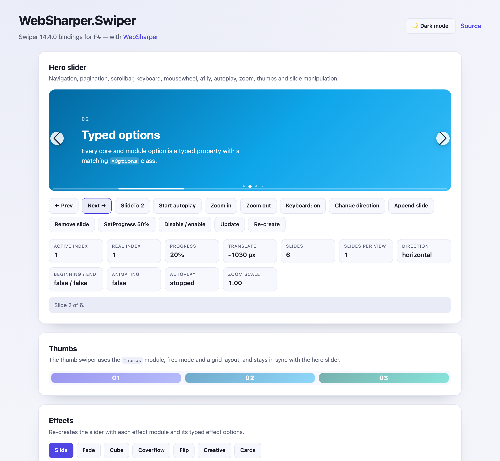

# WebSharper.Swiper

[](https://www.nuget.org/packages/WebSharper.Swiper)

WebSharper bindings for [Swiper](https://swiperjs.com/) 14.x (14.4.0+) — the
modern touch slider — for F# and C# web apps.

The binding consumes the npm package [`swiper`](https://www.npmjs.com/package/swiper)
as an ES module: the `Swiper` class is the default import from `swiper`, and every
feature module (`Navigation`, `Pagination`, `Autoplay`, `Zoom`, `Thumbs`, the six
effects, …) is a named import from `swiper/modules`. There is no CDN `<script>`
and no global `Swiper` object; your bundle step (esbuild in the sample) resolves
the import.

This repository contains:

| Project | Purpose |
| --- | --- |
| `WebSharper.Swiper` | The binding: the `Swiper` class, `SwiperOptions`, every module's options and instance API, all event handlers, and `SwiperModule` for the module imports. |
| `WebSharper.Swiper.Sample` | A WebSharper SPA (esbuild → `dist/`) that exercises the binding: a hero slider with navigation/pagination/scrollbar/keyboard/mousewheel/autoplay/zoom/manipulation, a synced thumbs slider (free mode + grid), and an effects slider that re-creates itself for each effect module. |

## Live demos

**Try it live:** [Open the sample in your browser](https://dotnet-websharper.github.io/swiper/)



The sample doubles as the binding's [test case](#running-the-test-case): it
creates three sliders, drives the module APIs from typed F# code, subscribes to
the typed events, switches effects, and shows the light/dark theme switcher (the
choice is persisted in `localStorage`).

- **Sample (this repository):** <https://dotnet-websharper.github.io/swiper/>
- **Source repository:** <https://github.com/dotnet-websharper/swiper>
- **WebSharper bindings:** <https://websharper.com/bindings>

## Install

```bash
dotnet add package WebSharper.Swiper
```

Or with Paket:

```fsharp
nuget WebSharper.Swiper
```

The package targets `netstandard2.0` and works with any WebSharper 10 or 11
project. It supports Swiper `>= 14.4.0 < 15.0.0`; Swiper itself comes from npm
(WebSharper registers it as an `NpmDependencies` entry), so the front-end bundle
step must resolve `swiper`. Swiper's stylesheet also ships with the npm package —
import `swiper/css/bundle` (or link `swiper/swiper-bundle.css`) next to it.

## Usage

All types live in the `WebSharper.Swiper` namespace.

### Create a slider

```fsharp
open WebSharper
open WebSharper.Swiper

[<JavaScript>]
let CreateSlider () =
    let options =
        SwiperOptions(
            Modules =
                [| SwiperModule.Navigation
                   SwiperModule.Pagination
                   SwiperModule.Autoplay |],
            Speed = 400,
            SpaceBetween = 16.,
            SlidesPerView = 1.,
            Loop = true,
            GrabCursor = true,
            Navigation = NavigationOptions(NextEl = ".next", PrevEl = ".prev"),
            Pagination = PaginationOptions(El = ".pagination", Clickable = true),
            Autoplay = AutoplayOptions(Enabled = false, Delay = 3000))

    new Swiper(".swiper", options)
```

`SwiperOptions` mirrors the JavaScript configuration object: every core option is
a typed property, the class-name and loop options are there, and each module's
options are a typed object (`NavigationOptions`, `PaginationOptions`,
`ScrollbarOptions`, `AutoplayOptions`, `KeyboardOptions`, `MousewheelOptions`,
`ZoomOptions`, `FreeModeOptions`, `GridOptions`, `ThumbsOptions`,
`VirtualOptions`, `ParallaxOptions`, `A11yOptions`, `ControllerOptions`,
`HashNavigationOptions`, `HistoryOptions`) or an effect's options
(`FadeEffectOptions`, `CubeEffectOptions`, `CoverflowEffectOptions`,
`FlipEffectOptions`, `CardsEffectOptions`, `CreativeEffectOptions`).

The one-argument form is available too, with `El` inside the options object:

```fsharp
new Swiper(SwiperOptions(El = "#hero", Speed = 300))
```

### Modules

Swiper 14 is modular: an option has no effect until its module is listed in
`Modules` (or installed once for the whole app).

```fsharp
let options =
    SwiperOptions(
        Modules = [| SwiperModule.Thumbs; SwiperModule.FreeMode; SwiperModule.Grid |],
        SlidesPerView = 3.,
        FreeMode = FreeModeOptions(Enabled = true, Sticky = true),
        Grid = GridOptions(Rows = 1, Fill = GridFill.Row),
        Thumbs = ThumbsOptions(Swiper = hero))

// Install one module globally instead of per instance:
Swiper.Use(SwiperModule.A11y) |> ignore
```

The available modules are `Virtual`, `Keyboard`, `Mousewheel`, `Navigation`,
`Pagination`, `Scrollbar`, `Parallax`, `Zoom`, `Controller`, `A11y`, `History`,
`HashNavigation`, `Autoplay`, `Thumbs`, `FreeMode`, `Grid`, `Manipulation`,
`EffectFade`, `EffectCube`, `EffectFlip`, `EffectCoverflow`, `EffectCreative` and
`EffectCards`.

The JavaScript boolean shorthand (`navigation: true`) is expressed by the module
option's `Enabled` property (`NavigationOptions(Enabled = true)`).

### Events

Use the typed `On` option, which carries every core and module event with its
real handler signature:

```fsharp
let options =
    SwiperOptions(
        Modules = [| SwiperModule.Navigation; SwiperModule.Autoplay |],
        On =
            SwiperEventHandlers(
                Init = (fun sw -> console.Log(sprintf "%d slides" sw.Slides.Length)),
                SlideChange = (fun sw -> console.Log(sprintf "slide %d" sw.ActiveIndex)),
                Progress = (fun _ progress -> console.Log progress),
                AutoplayTimeLeft = (fun _ timeLeft percentage -> console.Log(timeLeft, percentage)),
                TouchStart = (fun _ event -> console.Log event.Type),
                ZoomChange = (fun _ scale imageEl slideEl -> ())))
```

Handlers are also addable at runtime:

```fsharp
swiper.On("slideChange", fun (sw: Swiper) -> console.Log sw.RealIndex) |> ignore
swiper.OnAny(fun (name: string, data: obj) -> console.Log(name, data)) |> ignore
```

### Instance API and module APIs

```fsharp
swiper.SlideNext() |> ignore
swiper.SlideTo(2)
swiper.SlideToLoop(4, 300)
swiper.ChangeDirection() |> ignore          // horizontal <-> vertical
swiper.SetProgress(0.5, 400)
swiper.Update()
swiper.AppendSlide(newSlide.Dom)            // Manipulation module
swiper.RemoveSlide(swiper.Slides.Length - 1)

// Typed module sub-objects:
swiper.Navigation.Update()
let bullets = swiper.Pagination.Bullets
let running = swiper.Autoplay.Running
swiper.Autoplay.Start() |> ignore
swiper.Zoom.In(1.6)
let scale = swiper.Zoom.Scale
swiper.Keyboard.Disable()
swiper.Thumbs.Update(true)
swiper.Grid // SwiperGrid module API
swiper.Destroy()
```

Read-only state is exposed with its real type: `ActiveIndex`, `RealIndex`,
`Progress`, `Translate`, `Slides`, `VisibleSlides`, `IsBeginning`, `IsEnd`,
`Animating`, `IsLocked`, `AllowSlideNext`, `Params`, `Support`, `Device`,
`Browser`, `Touches`, …

### Effects

```fsharp
let coverflow =
    SwiperOptions(
        Modules = [| SwiperModule.Pagination; SwiperModule.EffectCoverflow |],
        Effect = Effect.Coverflow,
        CoverflowEffect =
            CoverflowEffectOptions(
                Rotate = 36.,
                Stretch = 0.,
                Depth = 120.,
                Modifier = 1.,
                SlideShadows = true))

let creative =
    SwiperOptions(
        Modules = [| SwiperModule.EffectCreative |],
        Effect = Effect.Creative,
        CreativeEffect =
            CreativeEffectOptions(
                Prev =
                    CreativeEffectTransform(
                        Translate = [| box "-40%"; box 0.; box -120. |],
                        Rotate = [| 0.; 0.; -25. |],
                        Opacity = 0.,
                        Scale = 0.85),
                LimitProgress = 2.))
```

`Effect` is a typed string union: `Slide`, `Fade`, `Cube`, `Coverflow`, `Flip`,
`Creative`, `Cards`. The other typed unions are `Direction`, `TouchEventsTarget`,
`GridFill`, `PaginationType`, `ControllerBy`, `FadeMode`, `SwipeDirection`,
`TranslateAxis`, `LanguageDirection`, `SlidesPerViewDynamicView`,
`MousewheelEventsTarget` and `SlidesPerViewAuto`.

### Breakpoints

`Breakpoints` is a typed, string-keyed object of `SwiperOptions`:

```fsharp
let breakpoints = Breakpoints.Empty
breakpoints.["768"] <-
    SwiperOptions(SlidesPerView = 2., SpaceBetween = 12.)
breakpoints.["1024"] <-
    SwiperOptions(SlidesPerView = 3., SpaceBetween = 16.)

let options = SwiperOptions(Breakpoints = breakpoints)
```

## Notes on the API

- **The package is npm-based.** The binding imports `swiper` and `swiper/modules`
  as ES modules; nothing is fetched from a CDN. Add `swiper` to your front-end
  dependencies (WebSharper registers it as an `NpmDependencies` entry) and include
  Swiper's CSS (`swiper/css/bundle`) in the page.
- **Modules are opt-in.** Without the matching `SwiperModule.*` in `Modules`, a
  module option is ignored and its instance API is `undefined`. Pass an array
  `[| … |]` to `Modules`.
- **Options are objects, not record literals.** Optional fields are set through
  the object-initializer syntax shown above; `SwiperOptions()` alone is the
  default configuration.
- **Union-typed options** (`NextEl`, `PrevEl`, `El`, `Swiper`, `SwipeHandler`, …)
  accept either case directly: `NextEl = ".next"` and `NextEl = element` both work
  (F# converts to the erased union).
- **Selector strings** are used as-is by Swiper; pass a CSS selector (`.swiper`
  is a class selector, `swiper` is a tag selector).
- **Events prefix.** `EventsPrefix` prepends a prefix to dispatched DOM events;
  the typed handler object is unaffected.
- **Migrating from WebSharper.Swiper 4.x.** That release bound Swiper 3 with a
  single `SwipeParameters` class and a CDN script. Swiper 14 replaced most of
  those options and names and made the library modular, so the binding was
  rewritten: `SwipeParameters` → `SwiperOptions`, `Effect`/`Direction`/… remain
  but with the current values, effect options are grouped per effect
  (`CubeEffectOptions`, `FadeEffectOptions`, …), and the callback options
  (`OnSlideChangeStart`, …) became the typed `On = SwiperEventHandlers(…)`
  object. This follows upstream: it is a breaking release.
- **Devices without touch support** still work (`SimulateTouch = true` for
  mouse-dragging), and the a11y module is typed separately
  (`A11yOptions(Enabled = true)`).

## Running the test case

The sample is a static SPA. Building it runs `npm install`, the WebSharper
compiler and esbuild, and emits `dist/` at the repository root:

```bash
dotnet build WebSharper.Swiper.Sample/WebSharper.Swiper.Sample.fsproj -c Release
dotnet serve -d dist -p 5188
```

`dotnet serve` comes from the [`dotnet-serve`](https://github.com/dotnet-serve/dotnet-serve)
tool; install it once with `dotnet tool install -g dotnet-serve` (or use
`dotnet tool run dotnet-serve` with a local tool manifest).

Open <http://localhost:5188/>. Swiper is bundled from npm, so no network access is
needed. The controls drive the binding: navigate, autoplay, zoom, keyboard,
direction change, append/remove slides, re-create the slider, and switch the
effects slider between all six effect modules.

## Building from source

### Prerequisites

- [.NET SDK 10](https://dotnet.microsoft.com/download) or later (the WebSharper
  11 line uses the .NET 11 preview SDK).
- [Node.js](https://nodejs.org/) (for the sample's esbuild step).
- [Paket](https://fsprojects.github.io/Paket/) as a local dotnet tool (configured
  in `.config/dotnet-tools.json`).

### Restore and build

```bash
dotnet tool restore
dotnet paket restore
dotnet build WebSharper.Swiper.sln -c Release
```

The binding targets `netstandard2.0`; the sample is a static bundle.

### Pack the NuGet package

After a Release build (so the assembly exists in `bin/Release/netstandard2.0`):

```bash
dotnet paket pack ./out
```

The pack template (`nuget/WebSharper.Swiper.paket.template`) ships the binding
`dll`, its XML documentation and — on the WebSharper 11 line — the
`.websharper` sidecar.

## Deployment

Pushing to the default branch triggers `.github/workflows/ghpages.yml`, which
builds the sample in Release and publishes `dist/` to the `gh-pages` branch via
GitHub Pages. The workflow restores with Paket against the WebSharper GitHub
registry, so it needs the `PAT_PACKAGE` secret.

## Repository layout

```
WebSharper.Swiper/                # the binding (WIG definitions)
  Main.fs
WebSharper.Swiper.Sample/         # static SPA demo / test case
  Client.fs
  index.html
  site.css
  esbuild.config.mjs
  wsconfig.json
docs/
  sample.png                      # screenshot of the running sample
nuget/                            # Paket pack template
.github/workflows/ghpages.yml     # build + deploy the sample
```

## License

Apache 2.0 — see [LICENSE.md](LICENSE.md).